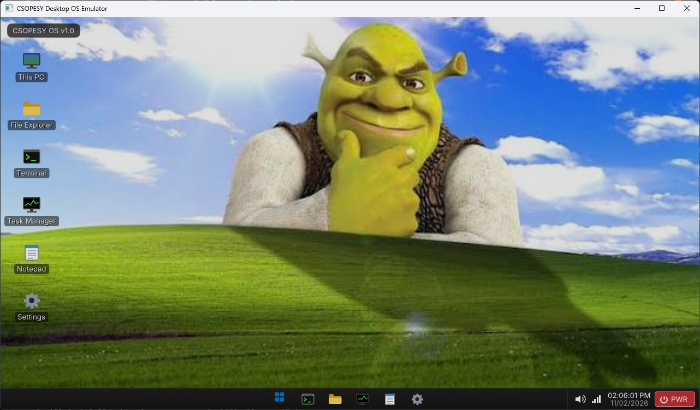
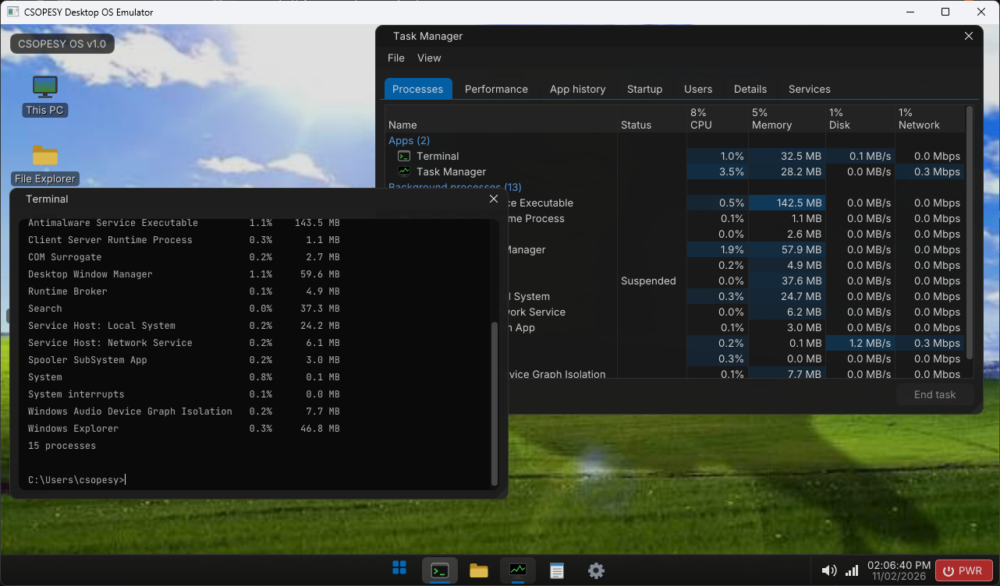

# CSOPESY Desktop-Style OS Mock-up

> **Archived.** This was Semi-Major Output 2 for CSOPESY (DLSU, 2026). It's kept read-only for reference and isn't maintained.

A fake desktop OS in C++: boot screens, a taskbar with quick settings, draggable windows, and five apps (Terminal, File Explorer, Task Manager, Notepad, Settings). Everything is driven by two text files, so you can reshape it without recompiling.





## Group

- Rainer Gonzaga
- Aaron James Gonzales
- Mariel Yasumuro
- Richmond Jose Ramos

## Built with

C++17, GLFW 3.5.1, OpenGL, Dear ImGui 1.92.9b. `stb_image` (in `third_party/`) loads the wallpaper from `assets/`.

CMake clones GLFW and Dear ImGui with git on the first build, so that build needs internet and git, and takes a minute longer.

Entry point: `src/main.cpp`.

## Running

**Visual Studio 2022** (needs the "Desktop development with C++" workload, which includes the CMake tools):

1. File > Open > Folder..., then pick this folder.
2. Wait for "CMake generation finished" in the Output window.
3. Pick `CsopesyOS.exe` from the startup item dropdown next to the green arrow.
4. Press Run.

**Terminal** (MinGW + Ninja, or any CMake setup):

```
cmake -S . -B build -G Ninja
cmake --build build
build\CsopesyOS.exe
```

## Configuration

Edit `config.txt` or `processes.txt`, save, then run again. The build step only copies them next to the exe, so nothing gets recompiled. When you run the exe directly, edit the copies next to it.

| Key | What it does |
| --- | --- |
| `window_width`, `window_height` | window size in pixels |
| `fullscreen` | true/false, fills the main monitor |
| `os_name` | shown on the desktop, terminal and shutdown screen |
| `user_name` | start menu, terminal prompt and `whoami` |
| `wallpaper` | image path next to the exe; a missing one falls back to a gradient |
| `desktop_icons` | true/false, the desktop shortcuts |
| `taskbar_position` | `top` or `bottom` |
| `taskbar_centered` | true/false, centers the start and app buttons |
| `clock_position` | `taskbar`, `top_left`, `top_right`, `bottom_left` or `bottom_right` |
| `clock_24h`, `clock_seconds` | true/false |
| `date_format` | strftime format of the long date, e.g. `%A, %B %d, %Y` |
| `volume` | starting volume, 0 to 100 |
| `brightness` | starting brightness, 10 to 100 |
| `wifi`, `bluetooth`, `night_light` | starting quick settings, true/false |
| `terminal_size`, `file_explorer_size`, `task_manager_size`, `notepad_size`, `settings_size` | starting window sizes, e.g. `640x400` |
| `process_file` | Task Manager's background processes (see below) |
| `total_memory_mb` | RAM used for Task Manager's memory percentages |
| `update_speed` | Task Manager refresh: `high`, `normal`, `low` or `paused` |
| `boot_screens` | true/false, BIOS and splash screens before the desktop |
| `cpu_name` | BIOS screen and Task Manager's Performance tab |
| `bios_memory_kb` | the BIOS memory test count |
| `fun_fact` | last BIOS line; empty hides it |
| `splash_seconds` | how long the splash screen stays, 0 to 60 |

`processes.txt` has one background process per line:

```
name, cpu %, memory MB, disk MB/s, network Mbps[, running or suspended]
```

A missing file keeps the built-in list. An empty one shows no background processes. An unknown key, bad value or bad line prints a warning in the console and keeps the default.

## Using it

**Boot.** BIOS screen, then the CSOPESY splash. Any key or click skips them.

**Desktop.** Double-click a shortcut to open that app. Click empty space to deselect.

**Taskbar.**
- Start menu lists every app. Type to filter, Enter opens the first match. Turn Off Computer is at the bottom.
- App buttons open the app or bring it to the front. Clicking the app that's already in front minimizes it. The blue line marks open apps.
- Speaker icon: volume slider and mute.
- Wi-Fi icon: quick settings (Wi-Fi, Bluetooth, Night light, volume, brightness). Brightness dims the whole screen; Night light tints it amber.
- Clock: click it for the date.
- PWR: asks before shutting down.

**Terminal.** Up and Down go through the command history.

| Command | Description |
| --- | --- |
| `help` | lists the commands |
| `clear` | clears the screen |
| `echo <text>` | prints the text back |
| `date` | current date and time |
| `ver` | the `os_name` from config.txt |
| `whoami` | `csopesy-pc\<user_name>` |
| `ps` | processes with their CPU and memory, same list as Task Manager |
| `open <app>` | opens an app, e.g. `open task manager` |
| `ping <host>` | fake replies, or an error when Wi-Fi is off |
| `ipconfig` | fake adapter info, disconnected when Wi-Fi is off |
| `kill <name>` | ends a process, same as End task. Part of the name works (`kill zoom`) as long as only one process matches |
| `shutdown` | opens the same dialog as PWR |
| `exit` | closes the terminal |

**File Explorer.** Placeholder folders and files. Double-click a folder or drive to open it. Back, forward and up work like Windows. Quick access is on the left.

**Task Manager.**
- Processes: open apps and background processes with live dummy usage. Click a header to sort, pick a row, then End task.
- Performance: CPU and memory graphs, process count and uptime.
- App history: CPU time and network per app since the OS started.
- Startup: placeholder startup apps.
- Users: the `user_name` with the combined usage.
- Details: every process with a PID, status and user.
- Services: placeholder Windows services.
- View > Update speed changes how often the numbers move. Paused freezes them.

**Notepad.** A plain text box. File > New clears it, Format > Word Wrap toggles wrapping. Nothing is saved to disk.

**Settings.** Read-only list of every config.txt value the OS started with. Handy for checking that an edit took effect.

**Shutting down.** The window's X button and Alt+F4 do nothing on purpose. Use PWR, Start > Turn Off Computer, or the `shutdown` command, then Turn Off.

## Source layout

```
src/main.cpp   window, frame loop, boot -> desktop -> shutdown states
src/Config.*   config.txt loader
src/core/      app table, clock, icons, power state, textures, theme
src/shell/     boot and shutdown screens, desktop, taskbar
src/apps/      Terminal, File Explorer, Task Manager, Notepad, Settings
```

Adding an app means writing its draw function and adding one row to the table in `src/core/Apps.cpp`.
